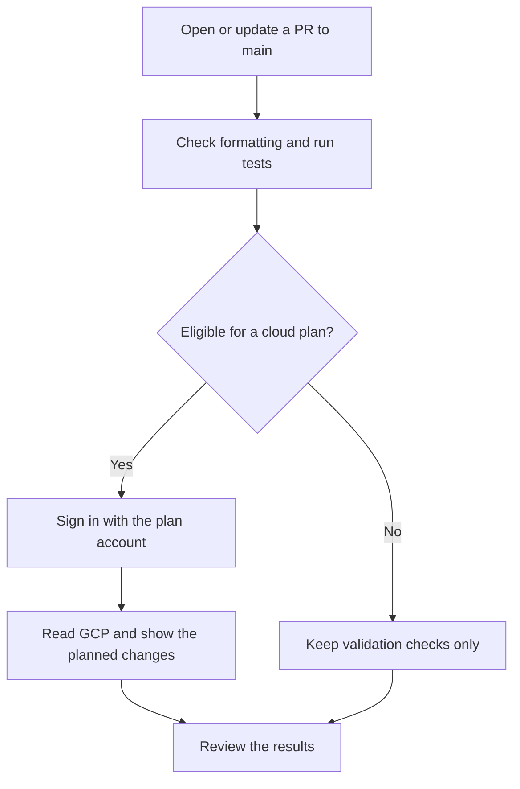
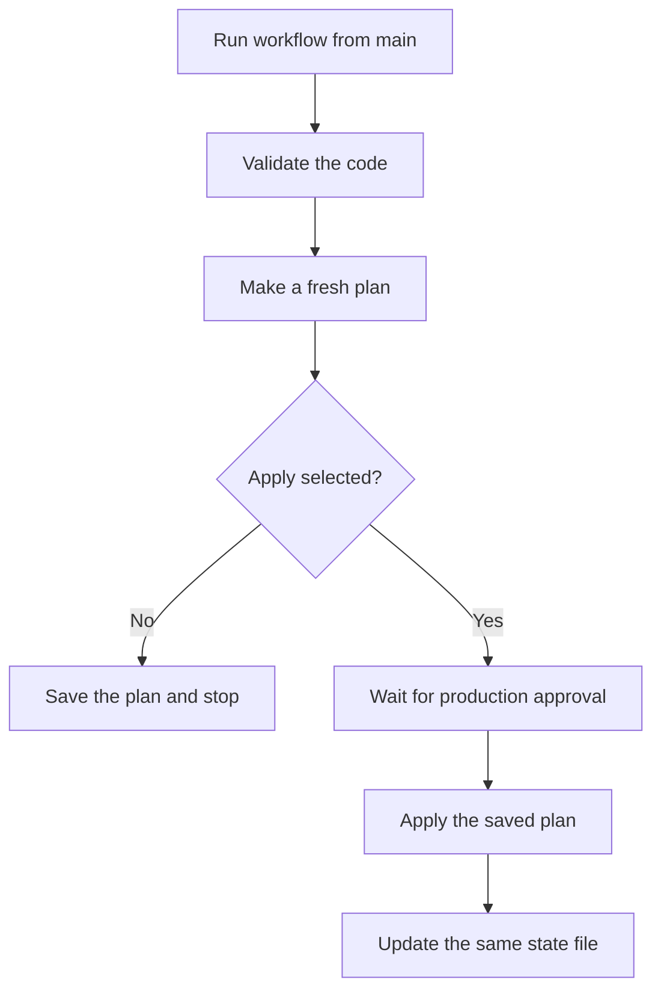
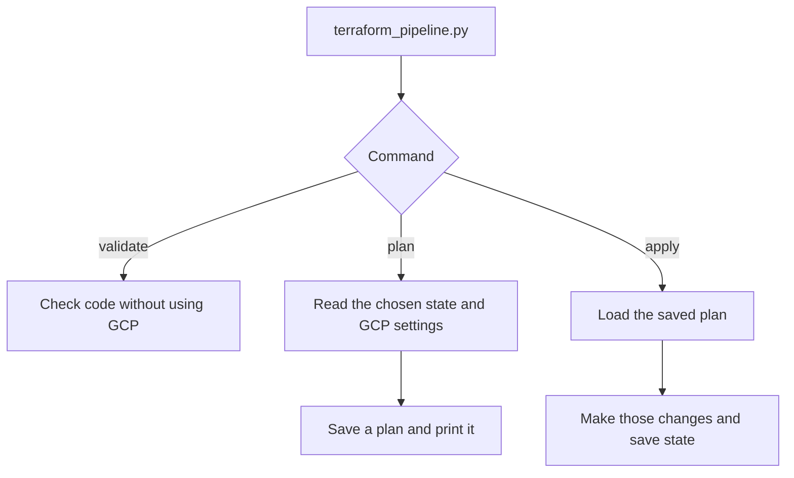

# Vobiz infrastructure guide

This repo creates and manages the cloud services used by Vobiz.

You describe what you want in Terraform files. The Python script runs the checks and Terraform commands. GitHub Actions runs the same steps for the team.

**A plan shows changes. An apply makes those changes in GCP.** Opening or merging a pull request does not deploy anything by itself.

## Start here

| What you want to do | Where to go |
|---|---|
| Set up GitHub variables and secrets | [GitHub settings](#github-settings) |
| Understand the folders | [Folder structure](#folder-structure) |
| Check the code on your laptop | [Local checks](#local-checks) |
| See a real cloud plan | [Run a real plan locally](#run-a-real-plan-locally) |
| Deploy through GitHub | [Deploy from GitHub](#deploy-from-github) |
| Add another service | [Add a new module](#add-a-new-module) |
| Remove a service | [Remove a resource or module](#remove-a-resource-or-module) |
| Understand the Python files | [How the Python scripts work](#how-the-python-scripts-work) |

## What this repo manages

| Folder | What it creates |
|---|---|
| `networking/` | VPC, subnets, routes, firewall rules, Cloud Router, NAT, and Private Service Access when configured |
| `registry/` | Docker image repositories in Artifact Registry and their access permissions |
| `cache/` | A private Redis cache |
| `secrets/` | Secret Manager containers and their access permissions |

A VPC is the private network. NAT lets private workloads make outbound internet connections. Private Service Access connects that network to services such as Redis.

Redis uses a private address, a password, and an encrypted connection. The registry and Secret Manager need Google permissions to use them; their Google API endpoints are still internet-reachable. Secret values are added separately, outside Terraform.

There is no naming module. Resource names come from the input file.

### Current GitHub deployment target

| Setting | Current value |
|---|---|
| GCP project | `project-6bf08560-ba66-45ad-926` |
| GCP project number | `216415340913` |
| Region | `asia-south1` |
| State bucket | `tainytails-vobiz-tfstate-216415340913` |
| State file inside that bucket | `terraform-state/prod/default.tfstate` |

GitHub runs use service accounts. Your local Google login is separate.

**Important:** `workloads/prod/backend.tf` still contains the original `vobiz-terraform` bucket as its default. The GitHub pipeline overrides it with `TF_STATE_BUCKET` and `TF_STATE_PREFIX`. For a local Tainytails plan or apply, use the backend file shown below too.

## Folder structure

```text
vobiz/
|-- .github/
|   `-- workflows/
|       `-- terraform-prod.yml       # The GitHub pipeline
|
|-- workloads/
|   `-- prod/                        # Run Terraform from this folder
|       |-- backend.tf              # Default state bucket settings
|       |-- providers.tf            # Google provider, project and region
|       |-- versions.tf             # Allowed Terraform versions
|       |-- .terraform.lock.hcl     # Provider versions and download checksums
|       |-- main.tf                 # Connects the networking folder
|       |-- platform.tf             # Connects registry, cache, secrets and APIs
|       |-- variables.tf            # Network input definitions
|       |-- platform-variables.tf   # Registry, cache and secret input definitions
|       |-- outputs.tf              # Network results
|       |-- platform-outputs.tf     # Registry, cache and secret results
|       |-- moved.tf                # Keeps track of the earlier folder move
|       |-- terraform.tfvars.example # Template for the complete input file
|       |-- example.tfvars          # Older networking example
|       |-- networking/             # Network service files
|       |-- registry/               # Container image service files
|       |-- cache/                  # Redis service files
|       |-- secrets/                # Secret Manager service files
|       `-- tests/                  # Terraform checks using fake cloud responses
|
|-- modules/
|   |-- networking/
|   |   |-- vnet/                   # Reusable network code
|   |   `-- cloud-router/           # Reusable router and NAT code
|   `-- gke/                        # Empty placeholder; no cluster is created
|
|-- landing-zone/
|   `-- organization/               # Empty placeholder; no organization setup
|
|-- tools/
|   |-- terraform_pipeline.py       # Runs validate, plan or apply
|   |-- check_network_security.py   # Checks firewall and private-network plans
|   `-- tests/                      # Checks the Python runner
|
`-- artifacts/                      # Local saved plans; not committed to Git
```

Most service folders contain these files:

| File | Simple meaning |
|---|---|
| `main.tf` | What to create |
| `variables.tf` | What information the folder needs |
| `outputs.tf` | What results the folder returns |
| `versions.tf` | Which provider versions it can use |

Terraform reads all `.tf` files directly inside `workloads/prod` together. File names such as `main.tf` and `platform.tf` help us organize the code; they are part of the same deployment.

Terraform does **not** load a subfolder just because it exists. The root needs a `module` block that points to that folder.

### Why there is one state file

State is Terraform's record of the resources it manages. It is kept in the GCS bucket, not in each service folder.

All service folders are connected to `workloads/prod`. The Python runner always uses that root and the `default` Terraform workspace. That keeps networking, Redis, registry, and secrets in one state file.

Do not add a backend inside a service folder or run separate deployments from those folders. Do not delete the state file to remove a resource.

## GitHub settings

Open **[Repository settings ? Secrets and variables ? Actions](https://github.com/sureeCC/vobiz/settings/secrets/actions)**.

- Use **Variables** for configuration that does not need to be hidden.
- Use **Secrets** for the protected Terraform input file.

### Required repository variables

Create these under **Variables ? New repository variable**. Copy the names exactly.

| Variable | What it is for |
|---|---|
| `GCP_WIF_PROVIDER` | Tells Google which GitHub identity provider to trust |
| `GCP_PLAN_SERVICE_ACCOUNT` | Google account used to read cloud settings and make a plan |
| `GCP_APPLY_SERVICE_ACCOUNT` | Google account allowed to create and update the services |
| `TF_STATE_BUCKET` | Bucket holding the shared state file |
| `TF_STATE_PREFIX` | Folder path inside that bucket |

For the current Tainytails setup, copy each value below into its matching GitHub variable.

**`GCP_WIF_PROVIDER`**

```text
projects/216415340913/locations/global/workloadIdentityPools/vobiz-github/providers/github
```

**`GCP_PLAN_SERVICE_ACCOUNT`**

```text
terraform-plan@project-6bf08560-ba66-45ad-926.iam.gserviceaccount.com
```

**`GCP_APPLY_SERVICE_ACCOUNT`**

```text
terraform-apply@project-6bf08560-ba66-45ad-926.iam.gserviceaccount.com
```

**`TF_STATE_BUCKET`**

```text
tainytails-vobiz-tfstate-216415340913
```

**`TF_STATE_PREFIX`**

```text
terraform-state/prod
```

`GCP_APPLY_SERVICE_ACCOUNT` can be left unset for plan-only use. If someone selects apply while it is unset, the workflow stops before deployment.

The plan account also needs state-bucket access so Terraform can lock the state while it works. The apply account needs permissions for the services being managed and for enabling their Google APIs. Adding another type of service may need another permission on the apply account.

### Required repository secret

Create this under **Secrets ? New repository secret**:

| Secret | What to put in it |
|---|---|
| `PROD_TFVARS_HCL` | The complete contents of the production Terraform input file |

Start with [terraform.tfvars.example](workloads/prod/terraform.tfvars.example). It shows the full format for networking, Redis, registry, and secrets.

For Tainytails, the project settings inside that input file must include:

```hcl
project_id = "project-6bf08560-ba66-45ad-926"
region     = "asia-south1"
network    = "projects/project-6bf08560-ba66-45ad-926/global/networks/prod-vpc"
```

These three lines are **only part of the file**. The secret also needs the other inputs from the template, including subnets and the services you want to manage. The template itself still uses the original Vobiz project, so update both `project_id` and the project ID inside `network` before using it for Tainytails.

When updating `PROD_TFVARS_HCL`, keep all existing entries that should remain deployed. GitHub replaces the whole secret value; it does not merge new lines into the old value. Removing a repository or secret entry can make Terraform plan its deletion.

Do not put application passwords, Redis passwords, or secret values into this file. The `secrets` map describes the Secret Manager containers and who may use them. Add the actual secret values in Secret Manager separately.

GitHub provides `GITHUB_TOKEN` automatically. You do not need to create a secret with that name. This workflow also does not need a Google service-account JSON key.

### Required GitHub environment

Open **[Settings ? Environments](https://github.com/sureeCC/vobiz/settings/environments)** and check `production`:

1. Add the person who can approve deployments. The current reviewer is `sureeCC`.
2. Allow deployments from `main` only.
3. Keep the approval step enabled.

The GCP project, billing, state bucket, service accounts, their permissions, and GitHub identity provider must already be set up. These were set up for the Tainytails project; the deployment script does not create its own login or state bucket.

### How GitHub gets Google access

GitHub asks Google for temporary access using Workload Identity Federation, also called OIDC. Think of it as a short-lived pass for that workflow run. There is no downloaded Google account key in the repo.

The current trust rules check this repository, its owner, the workflow file, and the allowed run type. The apply account can be used only by the `production` environment on `main`.

## What happens on a pull request



A real cloud plan runs for same-repository PR runs triggered by `sureeCC`. Forks, Dependabot, and other users get validation only. To allow another person to run cloud plans, update **both** the workflow's actor filter and the GCP identity-provider rule.

The PR workflow runs when files under `workloads/prod`, `modules`, or `tools` change, or when the workflow file changes. A README-only edit does not trigger these checks.

Find the result in the PR checks or the **Actions** page:

- `validate`: formatting, Terraform checks, tests using fake cloud responses, and Python tests.
- `plan`: the real GCP change list, when allowed.
- The job summary shows how many resources will be added, changed, or destroyed.
- The **Terraform plan** step contains the full readable plan.

**PR runs never apply changes.** They do not upload the saved binary plan either.

## Deploy from GitHub

1. Review the PR plan, especially the **to destroy** count.
2. Merge the PR into `main`.
3. Open **[Actions ? Production Terraform](https://github.com/sureeCC/vobiz/actions/workflows/terraform-prod.yml)**.
4. Click **Run workflow** and choose `main`.
5. Leave **apply** unchecked to make a plan only. Check it when you want to deploy.
6. Wait for checks and the fresh plan to finish.
7. If apply was selected, review that plan and approve the `production` deployment.
8. Wait for the apply job to finish. Check that it says `Apply complete!`.



Merging a PR does not start apply. A manual run with apply selected and production approval is required.

The plan job saves `prod.tfplan` and `provider-lock.hcl` together as the `production-plan` artifact. The apply job downloads them from the same run and restores the provider lock file before applying. This keeps provider checksums consistent between runners and avoids the checksum failure seen during the first deployment attempt.

Artifacts are kept for one day. If they expire, start a new workflow run and review its new plan. Saved plans and state can contain sensitive data, so do not post or commit them.

GitHub queues these production workflows under one shared group. Terraform also locks the state while planning or applying, so two jobs do not change it at the same time.

## How the Python scripts work

Python runs the steps in order. **Terraform is the tool that manages GCP resources.** Python does not search for folders and deploy each folder separately.



### `tools/terraform_pipeline.py`

| Command | What it does | Creates cloud resources? |
|---|---|---|
| `validate` | Checks formatting, downloads Google plugins and shared Terraform modules, checks Terraform files, runs tests using fake cloud responses, and checks the network test plans | No |
| `plan` | Connects to the state bucket, checks the files, compares the requested setup with GCP, saves a plan, and prints it | No; it may create a temporary state-lock object |
| `apply` | Checks that the saved plan exists, connects to the same backend, and applies that plan | Yes, and it can also update or delete resources listed in that plan |

Each command uses `workloads/prod`. The runner stops if a command fails. Plan and apply wait up to five minutes for another state lock to clear.

| Option | Meaning |
|---|---|
| `--var-file` | Input file for a plan; required for `plan` |
| `--backend-config` | File selecting the state bucket and prefix; use it for both plan and apply |
| `--plan` | Saved plan path; defaults to `artifacts/prod.tfplan` |

File paths you pass are read from your current terminal directory. The commands below assume you are in the repo's top folder.

### `tools/check_network_security.py`

The main Python runner imports this file during `validate`. You do not need to run it separately.

It reads the **test plans made with fake cloud responses** and checks that firewall settings are passed through correctly, private service ranges connect to the correct VPC, required APIs are included, and disabled features do not create unwanted resources. It does not inspect a live GCP deployment.

### `tools/tests/`

These Python tests check the runner itself: the chosen root, the default workspace, missing input files, backend options, and applying a saved plan without silently making another plan.

The Terraform scenarios under `workloads/prod/tests` check the infrastructure configuration. They use fake Google responses, so local validation needs no GCP login.

## Local checks

Install [Python](https://www.python.org/downloads/) and [Terraform](https://developer.hashicorp.com/terraform/install) first. The pipeline uses **Python 3.12** and **Terraform 1.16.6**; use those versions locally too for consistent results. Internet access is needed to download providers and public Terraform modules.

In PowerShell:

```powershell
cd C:\vobiz\Repository\vobiz
python tools/terraform_pipeline.py validate
python -m unittest discover -s tools/tests -v
```

These commands do not deploy resources or connect to the live state bucket.

If the formatting check fails, run:

```powershell
terraform fmt -recursive
python tools/terraform_pipeline.py validate
```

## Run a real plan locally

A real plan needs Google login credentials, access to the project and bucket, and valid input files.

1. Prepare `workloads/prod/terraform.tfvars` using the complete template. Keep existing deployed resource names and use the correct project values.
2. Create `workloads/prod/backend.hcl` for the same deployment:

```hcl
bucket = "tainytails-vobiz-tfstate-216415340913"
prefix = "terraform-state/prod"
```

3. Install the [Google Cloud CLI](https://docs.cloud.google.com/sdk/docs/install-sdk) if needed, then sign in:

```powershell
gcloud.cmd auth application-default login
```

Complete the browser sign-in with the account allowed to use this project. `.cmd` avoids the PowerShell script-policy error that can happen with `gcloud.ps1`.

4. Run the plan from the repo's top folder:

```powershell
python tools/terraform_pipeline.py plan --var-file workloads/prod/terraform.tfvars --backend-config workloads/prod/backend.hcl
```

The plan is saved as `artifacts/prod.tfplan`. Review all additions, changes, and deletions. A successful plan does not guarantee apply will succeed: permissions, quotas, or service availability can still cause a deployment to fail.

Use the GitHub approval flow for normal deployments. If a local apply is deliberately needed, review the saved plan first and use the **same backend file and computer/provider setup**:

```powershell
python tools/terraform_pipeline.py apply --backend-config workloads/prod/backend.hcl
```

Local apply has no GitHub approval gate; running that command applies the saved changes. The provider-lock handoff described above is handled by GitHub's workflow, not automatically by the Python script when you move a plan between computers.

## Add a new module

Creating a folder alone does not add a cloud service.

1. Create a folder, such as `workloads/prod/example-service`.
2. Add its resource definitions, inputs, and outputs.
3. Add a root module call in a `.tf` file directly under `workloads/prod`:

```hcl
module "example_service" {
  source     = "./example-service"
  project_id = var.project_id
}
```

This example only connects the folder. The folder must declare its `project_id` input and contain the real service definitions.

4. Connect required network links, Google APIs, and access permissions. Update the apply account's permissions if the new service needs them.
5. Add any new root inputs to `PROD_TFVARS_HCL`, keeping the existing entries.
6. Add useful Terraform tests and update any fixed checks in `check_network_security.py` if the tested setup changes.
7. Open a PR, review the plan, merge, and deploy using the normal flow.

The existing Python runner will include the new module through the root. You do not need a separate script, backend, state file, or workflow for that folder.

For another Docker repository or secret, you usually only need another entry in the existing `repositories` or `secrets` input map; you do not need a new module folder.

## Remove a resource or module

Deleting code does not immediately delete a cloud resource. Terraform first needs a valid plan, followed by an apply.

| Change | What happens next |
|---|---|
| Delete a folder but leave its module call | Validation fails; deployment does not proceed |
| Remove a module call | The next plan proposes deleting its managed resources |
| Remove an entry from `repositories` or `secrets` | The next plan proposes deleting that entry's resources |
| Set `cache = null` | The next plan proposes deleting Redis |
| Approve and apply a deletion plan | Terraform attempts those deletions |

Redis and secret containers have deletion protection enabled in `cache/main.tf` and `secrets/main.tf`. First disable the protection for the intended resource in code and apply that change. Only then remove its configuration and apply the deletion plan. The current secret protection setting is shared by the module's secret containers, so review its scope carefully when removing just one secret.

Check dependent resources before removing networking. Other services may still need that VPC or private connection.

Keep `moved.tf`; it records the earlier move into the networking folder. Changing folders for already-managed resources can change their Terraform addresses and needs a reviewed move, not just a file deletion.

## Useful things to remember

- **State file:** the record of resources Terraform manages. Keep the bucket, prefix, and workspace consistent. Changing them does not automatically move or adopt existing resources.
- **Provider lock file:** versions and checksums of Terraform's Google plugin. This plugin lets Terraform talk to GCP. It is separate from the state file and belongs in Git.
- **Saved plan:** the exact proposed changes from one run. Apply uses it instead of making a different plan.
- **Private access:** Redis needs the VPC, AUTH, and TLS. Applications still need identities and permissions to use the registry and secrets.
- **Names:** keep existing names unless you intend a replacement. Some cloud resources cannot be renamed in place.
- **Secret values:** the repo creates containers and access rules, not application secret versions.
- **Git:** do not commit real input files, local backend overrides, downloaded credentials, plans, or state files. The checked-in example files contain configuration examples, not application passwords.

## If something fails

| Message or problem | What to check |
|---|---|
| `gcloud.ps1 cannot be loaded` | Use `gcloud.cmd auth application-default login` |
| `could not find default credentials` | Complete the local Google login, or check the workflow's Google authentication step |
| Bucket missing or access denied | Check `TF_STATE_BUCKET`, `TF_STATE_PREFIX`, and the account's bucket permissions |
| Project or network not found | Check `project_id` and the project ID inside the `network` input |
| Permission denied during apply | Check the apply account's permissions for the resource/API named in the error |
| Apply is not configured | Set `GCP_APPLY_SERVICE_ACCOUNT` and complete its GCP trust/permission setup |
| Provider checksum mismatch | Check that apply downloaded `provider-lock.hcl` from the same run and restored it before initialization |
| State is locked | Check whether another plan or apply is running; do not remove an active job's lock |
| Deletion protection error | Disable protection and apply that change before removing the resource |
| Redis takes several minutes | Check the apply log and Redis status in GCP; first-time setup can take time |

If apply fails after creating some resources, keep the state file. Fix the reported issue, run a fresh plan against that same state, review it, and apply again. Do not delete the bucket or create a new state just to retry.
